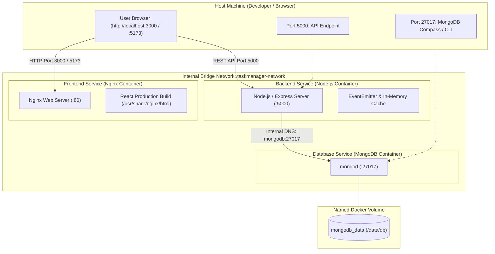

# Dockerization & Container Orchestration Guide

This document explains the containerization setup for the Task Management application using **Docker**, **Multi-stage Builds**, and **Docker Compose**.

---

## Architecture Overview



---

## Services & Ports Summary

| Service | Container Name | Image / Build Context | Container Port | Host Port | Description |
| :--- | :--- | :--- | :--- | :--- | :--- |
| **`mongodb`** | `taskmanager-mongodb` | `mongo:6.0` | `27017` | `27017` | Database engine with data persistence via named volume. |
| **`backend`** | `taskmanager-backend` | `./Dockerfile` (`node:20-alpine`) | `5000` | `5000` | Express REST API server connected to MongoDB. |
| **`frontend`** | `taskmanager-frontend` | `./client/Dockerfile` (Multi-stage) | `80` | `3000`, `5173` | Lightweight Nginx web server serving compiled React assets. |

---

## Key Features & Requirements

### 1. Multi-Stage Build for React Frontend ([`client/Dockerfile`](../client/Dockerfile))
- **Stage 1 (Build)**: Uses `node:20-alpine` to install dependencies via `npm ci` and compile the Vite + React app into `/app/dist`.
- **Stage 2 (Production)**: Uses lightweight `nginx:alpine` (~20MB). Copies *only* the compiled `/app/dist` files and a custom [`client/nginx.conf`](../client/nginx.conf).
- **Result**: Drastically reduces image size from ~450MB (with Node & devDependencies) to **~25MB**.
- **SPA Support**: Configured with `try_files $uri $uri/ /index.html;` to ensure client-side routing (React Router) works seamlessly on page refreshes.

### 2. Backend Dockerfile ([`Dockerfile`](../Dockerfile))
- Based on `node:20-alpine`.
- Uses `npm ci --omit=dev` to install only production dependencies.
- Embeds a `HEALTHCHECK` probe against the `/cache/stats` endpoint.

### 3. Named Volume Persistence
- The MongoDB service mounts the named volume `mongodb_data:/data/db`.
- All database collections, registered users, and created tasks persist across `docker-compose down` and container restarts.

### 4. Zero Manual Steps Startup
- The entire application stack starts with a single command:
  ```bash
  docker compose up --build
  ```
- **Health Checks & Startup Ordering**:
  - `backend` waits for `mongodb` to pass its health check (`mongosh ping`) before starting.
  - `frontend` starts after `backend` is initialized.
  - Backend includes automatic reconnection retry logic for MongoDB.

### 5. Exclusion via `.dockerignore`
- Root [`.dockerignore`](../.dockerignore) excludes `node_modules`, `.env`, logs, and sensitive data.
- Frontend [`client/.dockerignore`](../client/.dockerignore) excludes local `node_modules`, `.env`, and local `dist` artifacts.

---

## How to Run

### Start All Services
```bash
docker compose up --build
```
*(Or in detached background mode: `docker compose up --build -d`)*

### Access the Application
- **Frontend Web UI**: [http://localhost:3000](http://localhost:3000) or [http://localhost:5173](http://localhost:5173)
- **Backend API**: [http://localhost:5000](http://localhost:5000)
- **Cache Debug Stats**: [http://localhost:5000/cache/stats](http://localhost:5000/cache/stats)
- **Notification Logs**: [http://localhost:5000/notifications/logs](http://localhost:5000/notifications/logs)
- **MongoDB Direct Connection**: `mongodb://localhost:27017/taskmanager`

### Stop All Services
```bash
docker compose down
```

### Stop and Wipe Persistent Data (Optional)
```bash
docker compose down -v
```
*(The `-v` flag removes the named volume `mongodb_data` if a fresh state is desired).*

---

## Verification Checklist

1. **Containers Running**:
   ```bash
   docker compose ps
   ```
   All 3 containers (`taskmanager-mongodb`, `taskmanager-backend`, `taskmanager-frontend`) should show status `Up` / `healthy`.

2. **Network Connectivity**:
   ```bash
   docker network inspect taskmanager_internal_network
   ```
   Confirms all 3 containers reside on the same bridge network.

3. **Data Persistence**:
   - Create a task in the UI at `http://localhost:3000`.
   - Run `docker compose down`.
   - Run `docker compose up -d`.
   - Refresh `http://localhost:3000` to verify the task still exists.
