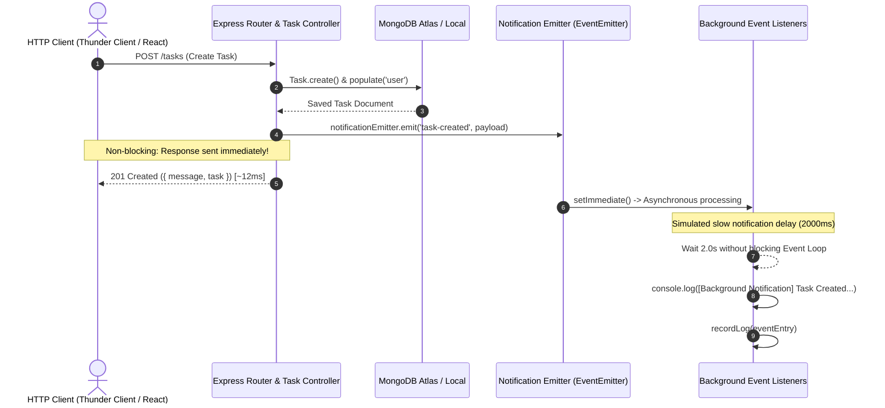

# Background Notification System (`EventEmitter`)

## Overview

The Task Management API implements an asynchronous, non-blocking background notification architecture using Node.js built-in **`EventEmitter`** from the `events` module.

When tasks are created or deleted, event notifications are dispatched decoupled from the main HTTP request/response pipeline. The API response returns immediately (typically within **10–15 ms**), while slower background operations—such as sending alerts, third-party webhook dispatches, logging, or slow third-party services (simulated with a **2000 ms** delay)—execute in the background without causing API latency or blocking the event loop.

---

## Architectural Workflow



---

## Key Features & Requirements

| Requirement | Implementation Detail | Status |
| :--- | :--- | :--- |
| **Node.js Built-in `EventEmitter`** | Implemented via `class NotificationEmitter extends EventEmitter` in [`utils/notificationEmitter.js`](file:///c:/Users/janup/Desktop/Task-Manager/utils/notificationEmitter.js). | Completed |
| **`task-created` Event** | Emitted upon successful task creation (`POST /tasks`). Handled asynchronously via `setImmediate()` + `setTimeout()`. | Completed |
| **Non-blocking API Response** | `res.status(201)` returns immediately. Does not `await` event listeners. HTTP duration remains ~10–15 ms even with a 2-second delay. | Completed |
| **Informative Notification Log** | Formats and logs: `Task Title`, `Timestamp`, and `Assigned User`. | Completed |
| **`task-deleted` Event** | Emitted upon task deletion (`DELETE /tasks/:id`). Has a separate listener with a distinct log format. | Completed |
| **`error` Event Listener** | Registered listener for the `'error'` event that intercepts exceptions inside handlers and logs them safely without crashing the Node process. | Completed |
| **Slow Handler Simulation** | 2000 ms simulated delay configurable via `delayMs`. | Completed |

---

## Event Definitions & Payloads

### 1. `task-created` Event

- **Trigger**: Fired by `createTask` in [`controllers/taskController.js`](file:///c:/Users/janup/Desktop/Task-Manager/controllers/taskController.js) after persisting to MongoDB.
- **Payload Schema**:
  ```json
  {
    "task": {
      "_id": "6ad6163cadd149041cbf8099",
      "title": "Prepare Annual Financial Audit",
      "status": "pending",
      "priority": "high",
      "user": {
        "username": "janup",
        "email": "janup@example.com"
      }
    },
    "user": { "username": "janup", "email": "janup@example.com" },
    "timestamp": "2026-10-19T13:08:12.285Z",
    "simulateError": false
  }
  ```
- **Console Output**:
  ```text
  [Background Notification] Task Created: "Prepare Annual Financial Audit" | Timestamp: 2026-10-19T13:08:12.285Z | Assigned User: janup@example.com
  ```

---

### 2. `task-deleted` Event

- **Trigger**: Fired by `deleteTask` in [`controllers/taskController.js`](file:///c:/Users/janup/Desktop/Task-Manager/controllers/taskController.js) when a task is removed.
- **Payload Schema**:
  ```json
  {
    "task": {
      "_id": "6ad6163cadd149041cbf8099",
      "title": "Prepare Annual Financial Audit"
    },
    "user": { "username": "janup", "email": "janup@example.com" },
    "timestamp": "2026-10-19T13:08:14.634Z"
  }
  ```
- **Console Output**:
  ```text
  [Background Notification] Task Deleted: "Prepare Annual Financial Audit" (ID: 6ad6163cadd149041cbf8099) | Timestamp: 2026-10-19T13:08:14.634Z | Action By: janup@example.com
  ```

---

### 3. `error` Event Listener

- **Trigger**: Fired whenever any event handler throws an unexpected exception or when error simulation is requested via `simulateError: true`.
- **Handling**:
  ```javascript
  this.on('error', (err) => {
    this.stats.errorCount++;
    const errorMessage = `[Notification System Error] ${err && err.message ? err.message : String(err)}`;
    console.error(errorMessage);
    this.recordLog({
      event: 'error',
      message: errorMessage,
      timestamp: new Date().toISOString()
    });
  });
  ```
- **Console Output**:
  ```text
  [Notification System Error] Simulated notification processing error for task: "Simulated Error Task"
  ```
- **Resilience**: In standard Node.js, an unhandled `'error'` event crashes the process. Registering an explicit `'error'` listener ensures that even if an email service fails, a network socket drops, or a notification fails, the API server remains 100% operational.

---

## Measured Performance & Sample Readings

The following benchmark was measured using [`scripts/benchmark-notifications.js`](file:///c:/Users/janup/Desktop/Task-Manager/scripts/benchmark-notifications.js) with 5 sequential `POST /tasks` requests while the background simulation delay was set to **2000 ms**:

| Sample # | Endpoint | API Response Time (ms) | HTTP Status | Background Execution Time | Was Main Response Blocked? |
| :---: | :---: | :---: | :---: | :---: | :---: |
| **#1** | `POST /tasks` | `103.29 ms` (cold start) | `201 Created` | `2000 ms` | **NO (Instant)** |
| **#2** | `POST /tasks` | `15.59 ms` | `201 Created` | `2000 ms` | **NO (Instant)** |
| **#3** | `POST /tasks` | `13.68 ms` | `201 Created` | `2000 ms` | **NO (Instant)** |
| **#4** | `POST /tasks` | `13.17 ms` | `201 Created` | `2000 ms` | **NO (Instant)** |
| **#5** | `POST /tasks` | `11.86 ms` | `201 Created` | `2000 ms` | **NO (Instant)** |

**Key Finding**: The API response is returned to the caller in **~13 ms** (a **~150x speedup** compared to waiting synchronously for the 2000 ms notification job to complete).

---

## Debug & Inspection Endpoints

For auditing, debugging, and testing through Postman, Thunder Client, or scripts, the following endpoints are available:

### 1. `GET /notifications/logs` or `GET /tasks/notifications/logs`
Returns the recent notification event logs, error logs, and execution statistics.

**Example Response**:
```json
{
  "stats": {
    "taskCreatedCount": 1,
    "taskDeletedCount": 1,
    "errorCount": 0,
    "delayMs": 2000,
    "activeLogsCount": 2
  },
  "logs": [
    {
      "id": "evt-1792415294634-k82x1",
      "event": "task-deleted",
      "title": "Prepare Annual Financial Audit",
      "taskId": "6ad6163cadd149041cbf8099",
      "deletedBy": "janup@example.com",
      "message": "[Background Notification] Task Deleted: \"Prepare Annual Financial Audit\" (ID: 6ad6163cadd149041cbf8099) | Timestamp: 2026-10-19T13:08:14.634Z | Action By: janup@example.com",
      "processedAt": "2026-10-19T13:08:14.635Z"
    },
    {
      "id": "evt-1792415294285-a7b32",
      "event": "task-created",
      "title": "Prepare Annual Financial Audit",
      "timestamp": "2026-10-19T13:08:12.285Z",
      "assignedUser": "janup@example.com",
      "message": "[Background Notification] Task Created: \"Prepare Annual Financial Audit\" | Timestamp: 2026-10-19T13:08:12.285Z | Assigned User: janup@example.com",
      "processedAt": "2026-10-19T13:08:14.286Z"
    }
  ]
}
```

### 2. `POST /notifications/reset` or `POST /tasks/notifications/reset`
Resets all counters and clears the log buffer.

### 3. `POST /tasks/notifications/delay`
Dynamically adjusts the simulated slow delay in milliseconds:
```json
{
  "delayMs": 1500
}
```

### 4. `POST /tasks/notifications/simulate-error`
Dispatches a background event that intentionally throws an error, confirming the `error` event listener catches and records the incident without affecting server health.

---

## How to Test

### Automated Verification Script
Run the automated test suite verifying all 6 requirements:
```bash
npm run test:notifications
```

### Automated Benchmark Script
Run the 5-sample timing measurement suite:
```bash
npm run benchmark:notifications
```

### Manual Testing with Postman / Thunder Client
1. **Create Task**:
   - `POST http://localhost:5000/tasks`
   - Headers: `Authorization: Bearer <TOKEN>`, `Content-Type: application/json`
   - Body: `{"title": "Test EventEmitter Task", "priority": "high"}`
   - Notice the response returns in **< 20ms**. In your terminal console, the notification log appears **2 seconds later**.
2. **Delete Task**:
   - `DELETE http://localhost:5000/tasks/<TASK_ID>`
   - Notice the distinct deletion notification logged in console.
3. **Simulate Error**:
   - `POST http://localhost:5000/tasks` with `{"title": "Error Task", "simulateNotificationError": true}`
   - The API returns `201 Created` immediately; 2 seconds later the `'error'` listener catches and prints `[Notification System Error]...`.
